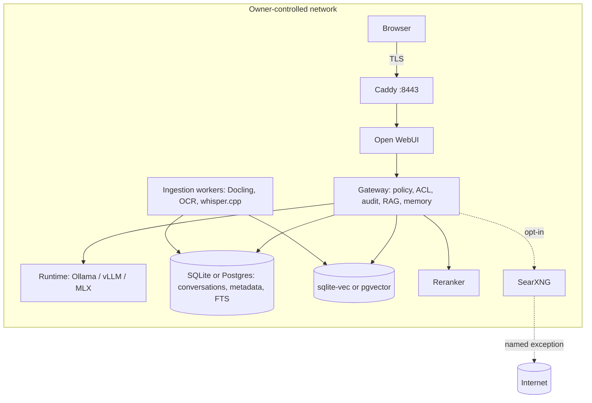
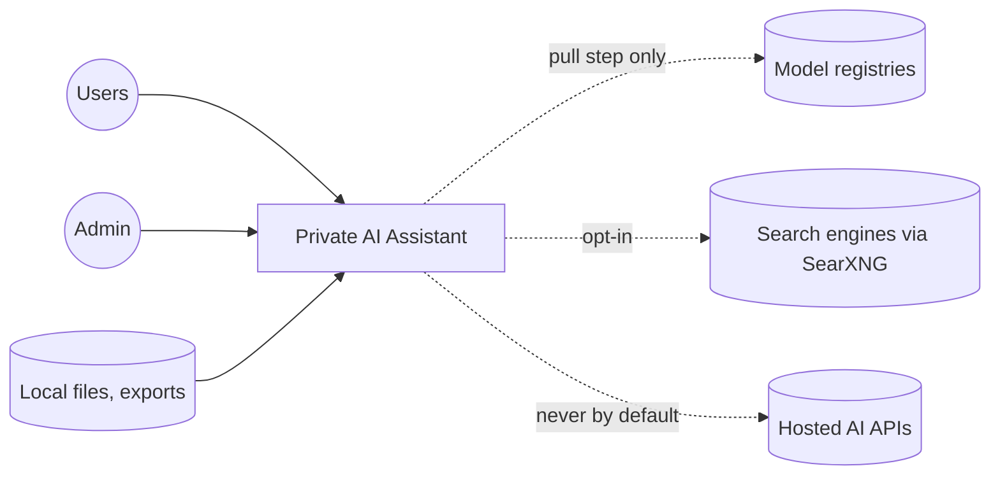
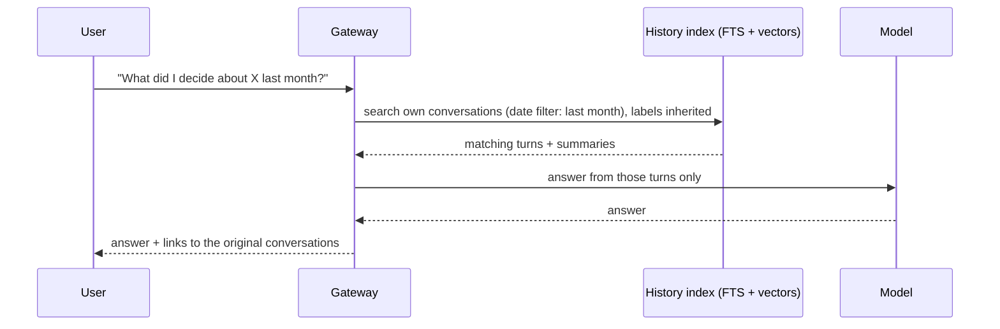
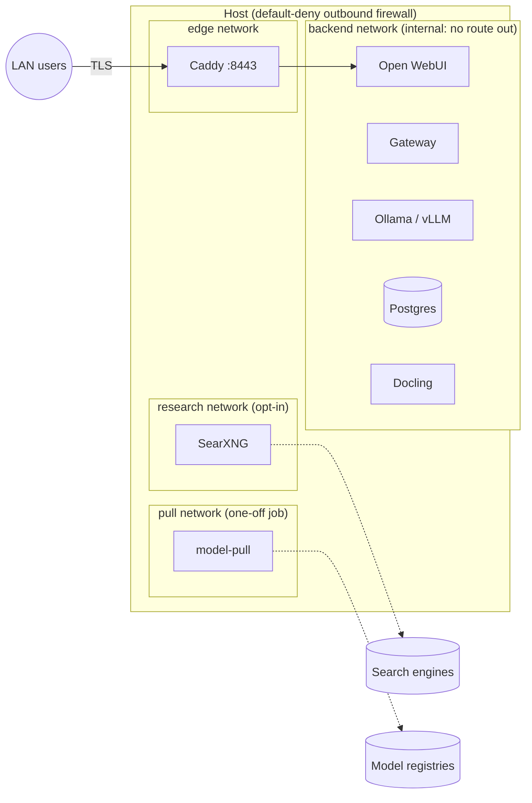

# Private Local AI Assistant: Architecture

Status: Phase 0 built (Right-Size Advisor, configuration, Compose skeleton). Phases 1–6 are
specified here and in `docs/IMPLEMENTATION_PLAN.md`. Every sizing, speed and price number is an
**estimate**. Model names, engine status and prices are **dated examples (October 2026)** that
`scripts/update-catalog` and `config/pricing.yaml` re-verify. They are not fixed facts.

---

## 1. Executive Summary

**For the business owner.** This system is a private AI assistant that runs on a computer you
own. It answers questions, drafts documents, searches your files and remembers past
conversations, and none of that leaves your building. It is built only from free, open
components. A short questionnaire picks the *smallest* setup that does your job, and states
what you do not need.

Local AI is **not** presented here as the cheap option. Hosted APIs, especially for open-weight
models, often cost less, and flat-rate subscriptions often give the most capability per dollar.
Every recommendation includes an honest three-year cost comparison. The case for local rests
on three things a provider cannot fully offer (Cahall, 2026):

- **Privacy:** prompts, documents and answers never leave your network. That is a simpler
  guarantee than any contract.
- **Security:** you control the model, its exact version, the serving software and who can
  reach it. No outside service joins your attack surface.
- **Availability:** there are no rate limits, no outages caused by other companies' demand and
  no surprise deprecations. A validated model behaves the same next month.

Open weights also allow **customization** that hosted models do not: training on your own
material, or distilling a large model into a faster one, without the data or weights leaving.

**For the technical owner.** A deterministic rules engine (the Right-Size Advisor) maps a
profile to capabilities, an inference engine, models and services. It sizes memory using
*total* parameters and speed using *active* parameters (MoE vs. dense), and it matches hardware
to workload shape: prefill is compute-bound and decode is bandwidth-bound. It generates `.env`,
Compose profiles, `policy.yaml`, a pull list and, on request, a security review packet. A
FastAPI **Gateway** owns policy, ACLs, audit, retrieval and memory. The UI is replaceable.
Egress is denied by default and proven by `make egress-test`.

## 2. Goals & Non-Goals

**Goals:**
- Run on hardware the owner controls, with zero egress by default.
- Recommend the smallest setup that meets the profile, and nothing it does not require.
- Provide personal RAG ("Recall") with citations, plus searchable conversation history.
- Keep the user's data exportable and deletable with one command each.
- Support tiers from one laptop to 250 users.
- Be honest about economics and licenses.

**Non-goals:**
- Training foundation models.
- Rack-scale data-center deployments. The advisor reports that a profile has "outgrown
  local" instead.
- Making compliance claims (HIPAA, PCI, GDPR). The system provides controls, not certification.
- Live account access by default.

## 3. Personas & Use Cases

| Persona | Typical jobs | Starter profile |
|---|---|---|
| Solo researcher | Q&A, research, writing, recall of notes and chats | `solo-researcher-16gb` |
| Privacy-conscious household | Paperwork, receipts, photo questions, shared server | `household-photos-docs` |
| Law / accounting office (10) | Search client files, drafting, strict confidentiality, air gap | `law-accounting-office-10` |
| SMB (50), sales + ops | Shared knowledge, drafting, transcription, agents, customization | `smb-50-sales-ops` |
| Software team (8) | Coding help, search over internal docs and code, always-on agents | `software-team-8` |

## 4. Principles

1. Local-first and zero-egress by default. Nothing leaves without a named, audited exception.
2. Least privilege. No stored passwords and no standing account access. Connectors are opt-in,
   read-only, scoped and revocable.
3. The user owns the data: plain formats, one-command export and one-command delete.
4. Encryption at rest (full disk) and in transit (LAN TLS). Secrets live in the OS keychain or a vault.
5. Auditability. Every retrieval, tool call and connector access is logged locally.
6. Commodity hardware, degrading gracefully to smaller models.
7. Open-source, permissively licensed components, with telemetry disabled and verified.
   LM Studio is free but closed source, so it is used only if the profile accepts that.
8. Control and availability. Model versions are pinned and checksum-verified, never upgraded
   silently, and the system does not depend on a third party's limits, outages or deprecations.
9. Honest economics. Local is justified by control, privacy, availability and customization,
   not by price.

## 5. Deployment Tiers

| | Tier 1: Personal | Tier 2: Home / small office | Tier 3: SMB on-prem |
|---|---|---|---|
| Users | 1, localhost | 2–20 over LAN | 20–250, SSO + RBAC |
| Hardware (examples) | Apple Silicon 16–64 GB; PC with 8–24 GB GPU | One GPU workstation (24–48 GB) or 64–128 GB unified-memory box | 1–3 GPU nodes or 128 GB+ unified-memory machines |
| Models (estimate) | 7–8B at Q4/Q5; MoE ~30B-A3B class if 32 GB+ | 14–35B, or MoE 26–35B with ~3–4B active | 35B MoE to 70B-class dense, plus small router |
| Runtime | Ollama (native on macOS) / MLX | Ollama; vLLM at 8+ sessions on NVIDIA | vLLM or SGLang |
| Decode speed (estimate) | 10–40 tok/s | 30–200+ tok/s (MoE fastest) | Per-user 20+ tok/s at peak |
| Concurrent sessions | 1 | 2–8 | 8–64+, humans + agents |
| Cost (estimate) | $0 on an existing machine | $1.3k–7k | $3k–35k; Pro AI Workstation ~$100k |
| Market hardware tier | Consumer AI Workstation | Consumer AI Workstation | Consumer (small) / Pro AI Workstation (large) |

The market's three hardware tiers (Cahall, 2026):

- **Consumer AI Workstation:** ordered online at a published price. Examples are Mac Studio,
  DGX Spark-class and AMD Ryzen AI Halo-class. In October 2026, 128 GB-class machines cost
  about $4k–7k: DGX Spark 128 GB was $6,950 after memory-driven increases, Ryzen AI Halo
  128 GB was $3,999 and Mac Studio M5 Max 128 GB was about $5,399.
- **Pro AI Workstation:** bought through a VAR on a quote, around $100k (DGX Station-class).
- **Enterprise AI infrastructure:** rack-scale. This is out of scope. If a profile needs it,
  the advisor reports "outgrown local".

A 128 GB-class unified-memory machine is a sensible default for a "serious SMB pilot".

## 6. Right-Size Advisor

```
profile.yaml ──► capabilities ──► runtime ──► hardware fit (or what to buy) ──► components
                (jobs, data,       (runtimes    (memory: TOTAL params; speed:      (+ license gates,
                 feature flags)     .yaml)       ACTIVE params; shape rules)         customization gates)
                                                                       └──► TCO ──► recommendation.md + configs
```

- **Intake.** There are three ways to create a profile: the CLI wizard (`make wizard`), an
  interview with a local LLM (`advise intake`, MODE: INTAKE) or a hand-written `profile.yaml`.
  Every profile is validated against `advisor/schema/profile.schema.yaml`, which uses the
  enums from Appendix A2. A few optional extensions (licensing scale, acknowledged triggers,
  runtime preferences) let the license-trigger and engine gates be checked.
- **Capabilities** come from `config/rules.yaml`, and a capability is enabled only by a job,
  a data type or an explicit feature flag. Scans get OCR. A vision model is added only for
  `image_understanding`. A code model is added only when coding is a job. Web research is
  added only when `features.web_research` is true and the profile is not air-gapped.
- **The runtime** comes from `config/runtimes.yaml`, using first-match rules:
  - NVIDIA with 8 or more sessions uses vLLM (SGLang is the alternative).
  - Apple Silicon uses native Ollama, with MLX as the faster alternative.
  - Non-technical users get Ollama.
  - TGI is never chosen; it is in maintenance mode.
  - TensorFold is used only with `allow_experimental`.
  - LM Studio is used only with `accept_closed_source`.

  If vLLM would leave no room for a required specialist model, the plan falls back to Ollama
  and says so.
- **Hardware fit.** Memory = weights (*total* params × bits/8) + KV cache (context × sessions ×
  bytes/token) + auxiliary models + runtime overhead. It must be at most 80% of usable memory.
  Sessions = peak human users + agents. The search order is:
  1. best model first (MoE gets a bonus when the latency target is instant, the workload is
     generation-heavy or agents are always on);
  2. then shorter context, halving down to 8K;
  3. then a q8_0 KV cache;
  4. then lower-precision weights.

  Decode speed is bandwidth ÷ bytes per *active* parameter. Prefill (time to first token) is
  TFLOPS ÷ (2 × *active* params). Both are checked against the latency target.
- **What to buy.** With no hardware given, or as upgrades, the advisor scores options from
  `config/pricing.yaml` by price. Prompt-heavy profiles pay a penalty on low-compute platforms.
  Generation-heavy profiles pay a penalty below 400 GB/s. Eight or more sessions on non-NVIDIA
  hardware pay a penalty because vLLM is not available there.
- **Output.** `recommendation.md` uses the EXPLAIN headers exactly as listed in Appendix A1.
  The advisor also writes `.env` (COMPOSE_PROFILES), `docker-compose.override.yml`,
  `config/policy.yaml`, the pull lists and `recommendation.json` (used for the diff on re-run),
  plus `SECURITY_REVIEW_PACKET.md` when `blockers` includes `security_review`.
- **The LLM's role.** The local LLM only words the result (`advise explain`). Its output is
  rejected, and the deterministic text used instead, if it does any of the following:
  - names a model the engine did not select;
  - calls local cheaper when the TCO says otherwise;
  - mentions abliteration that was never requested;
  - presents an excluded capability as needed;
  - drops a required section.

## 7. Logical Architecture



### Context diagram



## 8. Component Catalog

| Concern | Default | Alternatives | Why / when to switch |
|---|---|---|---|
| Runtime (T1–2) | Ollama (native on macOS) | llama.cpp, MLX, LM Studio (closed source) | Easiest model management. Switch to MLX for Apple speed, or llama.cpp for unusual hardware |
| Runtime (T3) | vLLM | SGLang, TensorRT-LLM | Continuous batching. SGLang for heavy prefix reuse; TensorRT-LLM for NVFP4 |
| Experimental runtime | — | TensorFold | Exact speculative decoding; self-reported speedups; never a default |
| Not recommended | — | HF TGI | In maintenance mode; HF itself points to vLLM, SGLang, llama.cpp, MLX |
| Chat UI | Open WebUI (telemetry off) | AnythingLLM, thin custom UI | Replaceable; policy lives in the Gateway. Open WebUI keeps its own copy of chats, so match its retention to the Gateway's |
| Gateway | FastAPI, framework-light | LlamaIndex/LangChain for parts | Keeps policy and ACL logic auditable |
| Vector store | T1 sqlite-vec; T2–3 pgvector | Qdrant, Chroma, LanceDB | One store holds vectors, FTS, metadata and ACLs; enforced inside the query (ADR-002) |
| Metadata / history | SQLite (T1), Postgres (T2–3) | — | FTS5 / tsvector for hybrid search |
| Parsing | Docling | Unstructured, Apache Tika | Local, layout-aware |
| OCR | Tesseract via Docling | PaddleOCR | Before any vision model |
| STT | whisper.cpp (size by memory) | faster-whisper | Only for audio jobs |
| Embeddings | nomic-embed-text; bge-m3 if multilingual | e5 | Small, local |
| Reranker | bge-reranker-base; v2-m3 if multilingual | — | Only for document recall |
| Identity | Authentik (OIDC + MFA) | Keycloak | T3 always; T2 when `features.sso` |
| Secrets | OS keychain / Vaultwarden | HashiCorp Vault | Short-lived scoped tokens only |
| Network | Compose (T1–2), k3s (T3) | — | Internal networks; Caddy is the only published port |
| Remote access | WireGuard / Tailscale | — | Never port-forward |
| Observability | Gateway health page (T1–2); Prometheus + Grafana + Loki (T3) | — | No external telemetry |

## 9. Data Flows

### Ingestion

```mermaid
sequenceDiagram
  participant W as Watched folder / upload / export
  participant I as Ingestion worker
  participant P as Docling + OCR / whisper.cpp
  participant R as Redaction + PII tagging (Presidio)
  participant E as Embedding model
  participant S as Store (rows + FTS + vectors)
  W->>I: new or changed file (hash)
  I->>I: dedupe by SHA-256; skip unchanged
  I->>P: parse (layout, tables, OCR, transcript)
  P->>R: text + structure
  R->>R: tag PII; assign sensitivity (collection default, never lower)
  R->>I: heading-aware chunks (~800 tokens, 15% overlap; code: per function/class)
  I->>E: embed chunks
  E->>S: vectors + metadata (source, path, date, author, tags, sensitivity, owner, ACL)
```

### Query / RAG

```mermaid
sequenceDiagram
  participant U as User
  participant G as Gateway
  participant S as Store
  participant K as Reranker
  participant M as Model runtime
  U->>G: question (+ filters: date, source, tag)
  G->>G: authenticate; resolve ACLs; Restricted locked unless unlocked this session
  G->>S: hybrid search (BM25 + vector) WITH ACL + sensitivity in the WHERE clause
  S-->>G: candidates
  G->>K: rerank top 50 -> top 8
  K-->>G: ranked chunks
  alt confidence below threshold
    G-->>U: "I don't know" + closest sources
  else
    G->>M: prompt with isolated, quoted context (retrieved text cannot call tools)
    M-->>G: answer
    G-->>U: answer + citations (file path, timestamp)
  end
  G->>S: audit: query, chunk ids, model version
```

### Conversation recall



### Connector access (opt-in, Phase 5)

Connector access works as follows:
- The OAuth flow is started by the user, using minimal read-only scopes. The token is stored
  in the vault.
- The Gateway fetches through the connector, logs `last_accessed`, and tags the results with
  the connector's collection label.
- Any write (send, post, purchase, delete) shows the exact payload and needs explicit
  confirmation.
- Each connector has its own kill switch.

## 10. Data Model

| Table | Key columns |
|---|---|
| `users` | id, display_name, role, sso_subject |
| `collections` | id, name, owner_id, default_sensitivity, retention_days |
| `collection_acl` | collection_id, principal (user/group), permission (read/write/admin) |
| `documents` | id, collection_id, path, sha256, mime, author, created_at, modified_at, sensitivity, deleted_at |
| `chunks` | id, document_id, ord, text, heading_path, tokens, sensitivity, tsv (FTS) |
| `embeddings` | chunk_id, model_id, vector |
| `conversations` | id, user_id, title, created_at, sensitivity (max of contents) |
| `messages` | id, conversation_id, role, content_redacted, model_id, model_digest, created_at |
| `retrievals` | message_id, chunk_id, score, rank |
| `tool_calls` | id, message_id, tool, args_redacted, confirmed_by, result_status |
| `summaries` | conversation_id, text, source_message_ids, sensitivity |
| `memory_cards` | id, user_id, text, source_message_id, approved_at, sensitivity |
| `audit_log` | ts, actor, action, object, detail, model_digest |
| `model_registry` | id, name, digest/revision, license, promoted_at, eval_run_id |

The metadata schema for each chunk is `source`, `path`, `date`, `author`, `tags[]`,
`sensitivity`, `owner`, `acl[]`, `collection` and `pii_tags[]`.

The **strictest-label rule** applies to everything derived from content. Chunks, embeddings,
summaries, memory cards and history entries all inherit the strictest sensitivity label of
their sources.

## 11. Personal RAG Design ("Recall")

- **Ingestion:** watched folders; upload; a local browser "save to Recall"; `.mbox`/`.eml`
  exports instead of mailbox access; Markdown, Obsidian and Apple Notes exports; PDFs and
  Office files; images through OCR; audio through STT.
- **Processing:** dedupe by hash; PII tagging with Presidio, run locally; heading-aware
  semantic chunks (~800 tokens, 15% overlap; code split by symbol); full metadata;
  incremental re-index on change.
- **Retrieval:** hybrid BM25 plus vector search, then metadata filters, then a rerank, then
  citations with path and timestamp. A calibrated "I don't know" threshold.
- **Sensitivity tiers:** Public, Personal, Confidential and Restricted. Restricted covers
  financial, medical and credentials-adjacent material. It is excluded from retrieval unless
  the owner unlocks it for the session.
- **Access control (Tier 2–3):** ACLs and sensitivity are part of the SQL `WHERE` clause, using
  Postgres row-level security. They are not applied as a filter in the UI afterwards.
- **Evaluation:** see section 18.

## 12. Conversation History & Memory Design

- **Storage:** every conversation is stored with its messages, model and model digest,
  retrieved chunk ids, tool calls and timestamps. The disk is encrypted; SQLCipher is
  optional on Tier 1.
- **History index:** a separate collection for "What did I decide about X?" questions. It
  inherits labels.
- **Memory layers:**
  - (a) session context;
  - (b) rolling summaries;
  - (c) memory cards. These are facts the user approved, which they can view, edit and delete.
- **Secrets:** a redaction pass runs before indexing, and secrets are never auto-saved.
- **Retention:** set per collection (30, 90 or 365 days, a firm-specific period such as
  2,555 days, or forever). A hard delete removes rows and vectors, and the backups on rotation.
- **Features:** a timeline, search by date, topic or person, and export to Markdown or JSON.

## 13. Security & Threat Model

| Threat | STRIDE | Controls |
|---|---|---|
| Device theft | I | Full-disk encryption; encrypted backups; screen lock; backup key kept offline |
| LAN intruder | S, I | TLS; SSO + MFA (T2 regulated, T3); only Caddy published; internal Docker networks |
| Malicious document / prompt injection | E, T | Retrieved text quoted and isolated; no tool execution from retrieved content; allowlisted tools; human confirmation for writes |
| Model supply chain | T | Revisions and checksums pinned; `make pull` is the only download step; licenses verified; no auto-upgrade; golden-set eval before promotion (ADR-008) |
| Ollama cloud models | I | `:cloud` tags refused by the pull job and forbidden by policy; egress default-deny |
| Dependency vulnerabilities | T, E | Image digests pinned; scheduled updates through the pull step; minimal containers; `no-new-privileges` |
| Insider misuse (T3) | I, R | RBAC; ACLs in queries; complete local audit log; Restricted unlocks logged |
| Backup leakage | I | restic encryption; offline rotation; delete propagates on rotation |
| Telemetry leaks | I | Telemetry flags off and verified per pinned version; egress test |
| Abliterated model misuse | E, R | ADR-007: off by default; admin approval plus justification; never for households or children's data; Gateway filters, audit and RBAC stay on; separate model id |
| Agent runaway | D | Watchdog, per-agent rate limits, pinned models, confirmations for writes |

**Privacy (aligned to GDPR/CCPA principles):**
- Data minimization: only the needed capabilities are enabled.
- Purpose limitation: each collection has a stated purpose.
- Access and portability: export.
- Erasure: hard delete.
- Retention limits.
- Security of processing.
- No sale or sharing of data.

**For SMBs:** HIPAA (health data) and PCI (card data) need their own risk analysis, BAAs and
controls. This system supports those programs but makes **no compliance claim**.

## 14. Privacy Controls

| Control | Where |
|---|---|
| Egress allowlist | `config/policy.yaml` (`egress`) |
| Sensitivity tiers and the strictest-label rule | `policy.yaml` (`sensitivity_tiers`, `derived_data`) |
| Retention and hard delete | `policy.yaml` (`retention`) |
| Connectors and scopes | `policy.yaml` (`connectors`) |
| Write-action confirmations | `policy.yaml` (`confirmations`) |
| Model pinning and promotion | `policy.yaml` (`model_pinning`) |
| Export and delete | `make export` / `make delete` (Phase 3) |

## 15. Networking & Egress Policy



- Only Caddy publishes a port. It binds to `127.0.0.1` on Tier 1, or to the LAN IP otherwise.
- Backend services sit on an `internal: true` network with no route out.
- Model downloads happen only in the one-off `model-pull` job.
- SearXNG has egress only when it is enabled, as a named exception.
- On macOS, Ollama runs natively. The host firewall therefore has to cover both Ollama and the
  UI's link to the host.
- `make egress-test` proves the network policy. Run it after every start and every image update.

## 16. Operations

- **Install:** `make wizard`, then `make advise`, `make secrets`, `make pull` (or
  `pull-native`), and finally `make up`.
- **Backups:** restic to an encrypted local repository plus an offline drive. Run a quarterly
  restore drill to a spare disk.
- **Updates:** images and models are updated offline-capably with checksums. A candidate goes
  through the golden-set eval before promotion, and the previous digest is kept for rollback.
- **Monitoring:**
  - GPU and RAM use, latency (time to first token and tok/s), queue depth, index freshness,
    failed ingestions and agent health.
  - On Tier 3 this runs in Grafana; on Tiers 1–2, on the Gateway health page.
- **Capacity rules of thumb (estimates):**
  - KV cache per session ≈ bytes/token × context.
  - 24 GB holds a ~14B dense model or a ~26B MoE at Q4 with 4 sessions at 16K.
  - vLLM on 48 GB serves about 15–20 concurrent sessions of a 35B-A3B MoE at 16K.

## 17. Performance & Sizing

- **Memory follows TOTAL parameters.** A 35B-total / 3B-active MoE needs memory like a ~35B
  dense model.
- **Decode speed follows ACTIVE parameters and memory bandwidth.** The same MoE generates
  roughly 10× faster than a 31B dense model on the same machine (estimate). This is why the
  advisor prefers MoE when responsiveness matters.
- **Prefill vs. decode.** Prefill reads the whole prompt and is compute-bound. Decode writes
  one token at a time and is bandwidth-bound.
  - Prompt-heavy work (large RAG contexts, long documents) favors high-compute GPUs. In
    Cahall's lab, DGX Sparks excel at prefill.
  - Generation-heavy work (drafting, code) favors high-bandwidth unified memory, where Macs
    excel at decode.
  - Balanced work goes to the best memory per dollar.
- **Advanced Tier 3 option:** pair machines over fast networking so that each one handles the
  phase it does best (disaggregated prefill/decode). This is optional.
- **Agents.** Always-on agents add concurrent sessions and KV cache, need pinned models and a
  watchdog, and gain the most from local availability.
- **Unified memory** (Apple, DGX Spark-class, Ryzen AI Halo-class) counts as model memory minus
  OS headroom: 67–75% on macOS, ~85% on DGX Spark-class and ~75% on Ryzen AI Halo-class
  (estimates).

## 18. Economics & TCO

`advisor/tco.py` estimates three years for four options:

1. **Local:** hardware (0 if the existing machine fits) + power + admin time + networking.
2. **Hosted open-weight API**, priced per million tokens.
3. **Frontier API.**
4. **Flat-rate subscription.** Always-on agents are billed separately, because subscriptions
   rarely cover them.

Prices come only from `config/pricing.yaml`, each with a `last_verified` date. Entries older
than 60 days, or never verified, are flagged in every recommendation. When an API or a
subscription is cheaper, the recommendation says so plainly, then gives the profile's
non-price reasons (from `priorities`).

Memory prices rose in 2026; the DGX Spark 128 GB, for example, went from $3,999 to $6,950. As a
result, high-memory machines may hold their resale value, but resale is not counted.

## 19. Customization Track (Phase 6, optional)

- **Post-training (LoRA)** happens only when it is requested with a justification, and only
  after the golden-set eval shows that RAG alone misses domain terms or behavior. It needs a
  dataset sensitivity review, versioned adapters, before-and-after evals and a base model
  whose license allows fine-tuning.
- **Distillation** is used when the profile needs larger-model quality on modest hardware or
  high concurrency. The teacher's license must allow distillation (`allows_distillation`).
- **Abliteration** (removing a model's refusals) is ADVANCED and OFF. It is enabled only when
  all of these hold:
  - it is requested, an admin has approved it, and a justification is recorded;
  - the profile is not a household and holds no children's data;
  - the Gateway filters, audit and RBAC stay on.

  It is never recommended automatically (ADR-007).

## 20. Evaluation Plan

- **Golden set:** 20–50 owner-written questions with expected source documents.
- **Metrics:** recall@5 and recall@10; answer faithfulness (claims supported by the cited
  chunks); citation accuracy (path and section correct); "I don't know" precision; time to
  first token and tok/s.
- **When it runs:** on every re-index, model change, quantization change or engine change.
  Promotion requires results no worse than the current version (ADR-008).
- **Advisor tests:** `make test` covers schema validation, the `expected:` blocks, exclusions,
  memory math (MoE vs. dense), licenses and triggers, the abliteration gates, cost honesty and
  the runtime rules.

## 21. Risks & Mitigations

| Risk | Mitigation |
|---|---|
| Catalog facts go stale (models, licenses, KV numbers) | Every entry is dated; `update-catalog`; `kv_note` flags estimates; conservative KV defaults |
| Prices change monthly | `pricing.yaml` with `last_verified`; stale flag |
| Sensitivity mislabels | Labels set per collection by default; automatic tagging only suggests labels; the strictest-label rule |
| Prompt injection via documents | Content isolation; no tool calls from retrieved text |
| Used GPUs in procurement picks | Shown as the cheapest option; Good/Better/Best offers new hardware |
| Experimental engines | Never defaults; explicit opt-in; keep a fallback |
| Owners over-trust estimates | Every number is labeled; the pilot plan measures the real thing |

## 22. Roadmap

See `docs/IMPLEMENTATION_PLAN.md`, Phases 0–6.

## 23. Glossary

- **Active parameters:** the parameters used for each token in an MoE model. They set speed.
- **Decode:** writing output tokens one at a time. It is bandwidth-bound.
- **Distillation:** training a smaller model to imitate a larger one.
- **Egress:** network traffic leaving the device or LAN.
- **KV cache:** per-session memory for attention keys and values. It grows with context.
- **MoE:** mixture of experts. Only some experts run per token.
- **Open-weight vs. open source:** open-weight means the weights can be downloaded; open source
  means the license meets the Open Source Definition.
- **Prefill:** reading the whole prompt before the first output token. It is compute-bound.
- **Quantization:** storing weights at fewer bits (Q4, Q8, AWQ, FP8).
- **RAG:** retrieval-augmented generation, meaning answering from your retrieved documents.
- **Total parameters:** all of a model's weights. They set memory.

## 24. References

- Ted Cahall, "Do You or Your Company Run AI Locally - Yet?", Agentilis.ai, LinkedIn, 14 Oct 2026.
  https://www.linkedin.com/pulse/do-you-your-company-run-ai-locally-yet-ted-cahall-brmge/
  (LinkedIn blocks automated reading, so the article was not re-read when this was written. Its
  specific claims were checked against the sources below.)
- Hugging Face TGI documentation, maintenance-mode notice: https://huggingface.co/docs/text-generation-inference/en/index
- TensorFold review (MIT; self-reported speedups): https://flowtivity.ai/blog/tensorfold-inference-engine-review/
- Gemma 4 under Apache 2.0: https://opensource.googleblog.com/2026/03/gemma-4-expanding-the-gemmaverse-with-apache-20.html; model card https://huggingface.co/google/Gemma-4-31B
- Qwen3.6-35B-A3B specs: https://apxml.com/models/qwen36-35b-a3b
- Qwen3.8-Flash-Next architecture and license: https://intuitionlabs.ai/articles/qwen3-8-flash-next-architecture-memory
- GLM-5.3 weights and license: https://www.noze.it/en/insights/glm-5-3-weights-licence-benchmark-method/
- DGX Spark pricing (Oct 2026): https://www.implicator.ai/nvidia-adds-64gb-dgx-spark-at-4-999-as-128gb-model-climbs-to-6-950/
- AMD Ryzen AI Halo pricing: https://hothardware.com/news/amd-ryzen-ai-halo-dev-kits-hit-retail-128gb-ram-3999-price-tag
- Ollama tags (third-party listing): https://www.morphllm.com/best-ollama-models


## Implementation status (October 2026)

Phases 0 to 6 are implemented in `advisor/`, `gateway/`, `deploy/` and `scripts/`, with tests in
`tests/`. Row-level security is tested against Postgres 16 with pgvector. Real model serving, GPUs,
a live OIDC provider and the k3s manifests have not been exercised in CI; see the README's Status
section. The browser version of the advisor (`site/`) is checked against the Python engine by
`tests/test_site_parity.py`.
