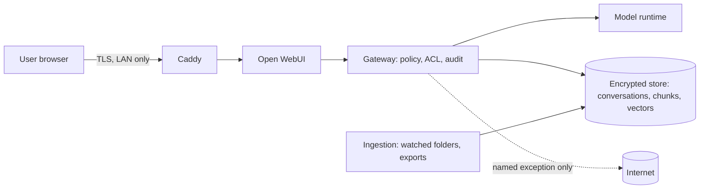

# Security Review Packet: {{PROFILE}}

Generated by the Right-Size Advisor for a reviewer who needs to approve a private, local AI
assistant. Every value comes from the deterministic recommendation (`recommendation.json`).
Figures are estimates. This packet supports a review; it is not a compliance certification.

## 1. System summary

- Deployment tier: {{TIER}}
- Inference runtime: {{RUNTIME}}
- Components:

{{COMPONENTS}}

## 2. Data flows

All processing happens on hardware the owner controls. The only arrow that can leave the
network is a named, audited exception in `config/policy.yaml`.

## 3. Egress policy

- {{EGRESS}}
- Connectors: {{CONNECTORS}}
- Cloud burst: {{CLOUD_BURST}}
- Verification: `make egress-test` must pass after every start and every image update.
- Ollama `:cloud` model tags are forbidden; they would run prompts on a third party's servers.

## 4. Threat model (summary)

| Threat (STRIDE) | Example | Controls |
|---|---|---|
| Spoofing | LAN intruder poses as a user | SSO + MFA (tier 2 regulated / tier 3), per-user accounts, TLS |
| Tampering | Swapped model file or image | Checksum-pinned models, image digests, no auto-upgrade |
| Repudiation | "I never searched that client file" | Local audit log of every retrieval, tool call and connector access |
| Information disclosure | Restricted data in an answer or a summary | Restricted tier excluded unless unlocked; labels inherited by summaries, memory cards and history; ACLs in the DB query |
| Denial of service | One heavy user or agent starves others | Parallel-session limits, queueing, watchdog for agents |
| Elevation of privilege | Prompt injection in a document triggers a tool | Retrieved text never triggers tools; allowlisted tools; write actions need human confirmation |
| Supply chain | Malicious dependency or telemetry | Pinned versions, telemetry disabled and verified, egress default-deny |
| Device theft / backup leak | Laptop or backup drive lost | Full-disk encryption, encrypted restic backups, key stored offline |

## 5. Model provenance and licenses

| Model | Role | License | Commercial use | Source | Revision |
|---|---|---|---|---|---|
{{MODEL_TABLE}}

{{LICENSES}}

Open-weight is not the same as open source. Read each license, and record acknowledgements of
any blocking `commercial_triggers` in the profile (`licensing.acknowledged_triggers`).

## 6. Pinning and update process

1. New model or image versions are downloaded only in the separate pull step (or imported offline).
2. Checksums and revisions are recorded (`generated/model-pins.txt`, image digests in `.env`).
3. The candidate runs the local golden-set eval (recall@k, answer faithfulness, citation accuracy).
4. It is promoted only if it matches or beats the current version; otherwise it is rolled back.
5. Nothing upgrades automatically.

## 7. Access control and retention

- Access control: {{ACL}}
- Restricted tier: {{RESTRICTED}}
- Retention: {{RETENTION}}; hard delete removes rows, vectors and backups on rotation.
- Customization status: {{CUSTOMIZATION}}

## 8. Compliance note

{{COMPLIANCE}}

## 9. Reviewer sign-off

| Item | Reviewer | Date | Result |
|---|---|---|---|
| Egress test passed | | | |
| Disk encryption verified | | | |
| SSO / MFA verified (if applicable) | | | |
| Licenses reviewed | | | |
| Backup restore drill done | | | |
