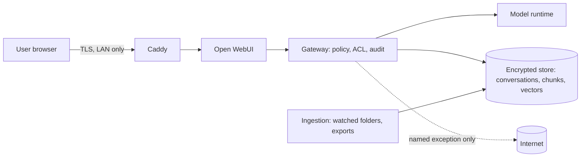

# Security Review Packet: Example Distribution Co.

Generated by the Right-Size Advisor for a reviewer who needs to approve a private, local AI
assistant. Every value comes from the deterministic recommendation (`recommendation.json`).
Figures are estimates. This packet supports a review; it is not a compliance certification.

## 1. System summary

- Deployment tier: 3 - SMB on-prem
- Inference runtime: vLLM
- Components:

- vLLM (OpenAI-compatible): 8+ concurrent sessions on NVIDIA: continuous batching gives far higher throughput.
- Ollama sidecar: Serves embeddings and any small or specialist models.
- Open WebUI: Chat UI bound to localhost/LAN, telemetry disabled.
- Caddy reverse proxy: Caddy (only container with a published port; local CA TLS)
- Gateway: The only path to the model: policy, access rules, audit log, Recall, memory and searchable history.
- Encrypted backups (restic): restic (encrypted) to local disk + optional offline drive
- Model pinning: Model files pinned by checksum; no auto-upgrade; a new version must pass the golden-set eval before promotion.
- Postgres: Shared conversation, metadata and ACL store for multiple users.
- Per-user accounts: Every person has their own login and history.
- Postgres + pgvector + tsvector (row-level security for ACLs): Semantic + keyword (hybrid) search over documents and history.
- Docling document parser: Parses PDFs, Office files and email exports locally.
- whisper.cpp server: Meetings and voice notes need local speech-to-text.
- SearXNG (private web research): Private metasearch: searches are not tied to your identity. The only service allowed outbound, and only to search engines. Regulated data is present, so this is a named, audited egress exception you opted into.
- Authentik (OIDC SSO + MFA): Central login with MFA (requested)
- Role-based access control: Roles from SSO groups decide which collections each user can search.
- Prometheus + Grafana + Loki: Capacity, latency, queue depth and ingestion monitoring.
- Agent watchdog: Always-on agents: health checks, automatic restart, alerts; runs only pinned models.
- Scoped read-only connectors: calendar_readonly: Requested. OAuth with minimal read-only scopes, tokens in the vault, per-connector kill switch, 'last accessed' log. (Phase 5)

## 2. Data flows

All processing happens on hardware the owner controls. The only arrow that can leave the
network is a named, audited exception in `config/policy.yaml`.

## 3. Egress policy

- Deny all outbound by default. Model downloads happen only in a separate `make pull` step. SearXNG may reach search engines (named exception).
- Connectors: calendar_readonly (read-only)
- Cloud burst: off
- Verification: `make egress-test` must pass after every start and every image update.
- Ollama `:cloud` model tags are forbidden; they would run prompts on a third party's servers.

## 4. Threat model (summary)

| Threat (STRIDE) | Example | Controls |
|---|---|---|
| Spoofing | LAN intruder poses as a user | SSO + MFA (tier 2 regulated / tier 3), per-user accounts, TLS |
| Tampering | Swapped model file or image | Checksum-pinned models, image digests, no auto-upgrade |
| Repudiation | "I never searched that client file" | Local audit log of every retrieval, tool call and connector access |
| Information disclosure | Restricted data in an answer or a summary | Restricted tier excluded unless unlocked; labels inherited by summaries, memory cards and history; ACLs in the DB query |
| Denial of service | One heavy user or agent starves others | Parallel-session limits, queueing, watchdog for agents |
| Elevation of privilege | Prompt injection in a document triggers a tool | Retrieved text never triggers tools; allowlisted tools; write actions need human confirmation |
| Supply chain | Malicious dependency or telemetry | Pinned versions, telemetry disabled and verified, egress default-deny |
| Device theft / backup leak | Laptop or backup drive lost | Full-disk encryption, encrypted restic backups, key stored offline |

## 5. Model provenance and licenses

| Model | Role | License | Commercial use | Source | Revision |
|---|---|---|---|---|---|
| Qwen3.6 35B-A3B | general | Apache-2.0 | yes | Qwen/Qwen3.6-35B-A3B | pin at install |
| BGE-M3 | embeddings | MIT | yes | bge-m3 | pin at install |
| BGE Reranker v2 M3 | reranker | Apache-2.0 | yes | BAAI/bge-reranker-v2-m3 | pin at install |
| Whisper large-v3-turbo (whisper.cpp) | stt | MIT | yes | ggml-large-v3-turbo.bin | pin at install |
| Qwen3 1.7B | fast_small | Apache-2.0 | yes | qwen3:1.7b | pin at install |

- Qwen3.6 35B-A3B: Apache-2.0; OSI open source: yes; triggers: none
- BGE-M3: MIT; OSI open source: yes; triggers: none
- BGE Reranker v2 M3: Apache-2.0; OSI open source: yes; triggers: none
- Whisper large-v3-turbo (whisper.cpp): MIT; OSI open source: yes; triggers: none
- Qwen3 1.7B: Apache-2.0; OSI open source: yes; triggers: none

Open-weight is not the same as open source. Read each license, and record acknowledgements of
any blocking `commercial_triggers` in the profile (`licensing.acknowledged_triggers`).

## 6. Pinning and update process

1. New model or image versions are downloaded only in the separate pull step (or imported offline).
2. Checksums and revisions are recorded (`generated/model-pins.txt`, image digests in `.env`).
3. The candidate runs the local golden-set eval (recall@k, answer faithfulness, citation accuracy).
4. It is promoted only if it matches or beats the current version; otherwise it is rolled back.
5. Nothing upgrades automatically.

## 7. Access control and retention

- Access control: Per-user and per-collection ACLs enforced in the database query (Postgres row-level security), not only in the UI.
- Restricted tier: enforced
- Retention: conversations 365 days; documents keep_until_deleted; hard delete removes rows, vectors and backups on rotation.
- Customization status: post_training: planned, distillation: planned, abliteration: not_requested

## 8. Compliance note

Regulated data present. These controls support privacy obligations but do not by themselves make you compliant with HIPAA, PCI, GDPR or similar; review with your compliance advisor.

## 9. Reviewer sign-off

| Item | Reviewer | Date | Result |
|---|---|---|---|
| Egress test passed | | | |
| Disk encryption verified | | | |
| SSO / MFA verified (if applicable) | | | |
| Licenses reviewed | | | |
| Backup restore drill done | | | |
